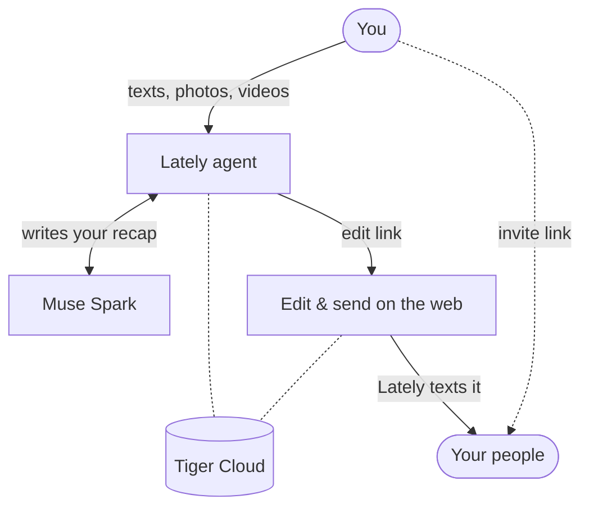

# 💌 Lately

**Lately turns your everyday moments into beautiful weekly recaps that keep your favorite people in the loop.**

[](https://devpost.com/software/hacktx-project-ail5h9)


**Can't keep up with everyone, but wish you could? Look no further.**

Life moves fast. The little moments worth sharing (a dinner that ran late, a detour that made your day, a small win) get buried before the people who'd care ever hear about them. Social media gets the highlight reel; group chats go quiet.

We wanted to give your people the inside scoop on your life, without the pressure of starting a conversation when you're busy, and to bring back the feeling of getting mail from someone who's thinking of you.

**Try it:** [hacktx26-ruddy.vercel.app](https://hacktx26-ruddy.vercel.app) · [Sample recap](https://hacktx26-ruddy.vercel.app/postcard)

## 💬 What it does

**Lately is an iMessage companion that captures the moments in your week worth remembering and sharing.**

- **Just text it.** Throughout the week, send Lately notes, photos and videos, the same way you'd text a friend. It replies like one too: warm, short, and curious about your week.
- **Ask for a recap.** When things slow down, text "recap" (or "make one for Maya") and Lately turns your week into a beautiful recap: a headline, short stories, your photos, recommendations, and what's coming up.
- **Make it yours.** Lately texts you a private link where you can preview the recap and edit any line in place.
- **Share it with your people.** Share your invite link once. Friends sign up with a single text, and every time you hit Send, Lately texts them your recap. No app to download, no account to create.

### ✨ Features

- **Natural iMessage conversation** powered by Meta's Muse Spark: it learns your name and understands recap requests however you phrase them.
- **AI-written recaps** built only from what you actually shared, never invented.
- **Smart photo grouping:** photos sent together stay together, and Muse places context-free photos into the story they fit, shown as collages or swipeable stacks.
- **A playful opener** at the top of every recap, gentle when the week was hard.
- **Recommendations with links:** books go to Bookshop, places to Maps, songs to Spotify.
- **Interactive touches:** confetti for good-news weeks, tap-to-reveal spoilers, and a read-aloud mode with a natural in-browser voice.
- **No pressure:** recipients never have to reply.

## 🛠️ How we built it

Lately has two halves that share one database:

- **The iMessage agent (TypeScript, Node.js):** connects to iMessage through Photon Spectrum, a cloud iMessage provider. Each incoming message is handled in order per person. Muse Spark writes the replies and the recaps.
- **The web app (Next.js 16 on Vercel):** the recap pages, the in-place editor, sign-up, and invite pages. Recaps use private, unguessable links: an edit link for the owner and a separate read-only link for subscribers. There are no accounts or passwords to manage.
- **The database (Tiger Cloud):** both halves read and write the same Postgres database on Tiger Data.

### 🗺️ Architecture



1. You text Lately notes, photos, and videos over iMessage (via Photon Spectrum).
2. When you ask for a recap, the agent pulls your week from Tiger Cloud and Muse Spark writes it.
3. Lately texts you a private edit link; you review and edit the recap on the web.
4. When you hit Send, Lately texts the recap to everyone who subscribed through your invite link.

### 🧠 Built with Meta's Muse Spark

**AI isn't a feature on top of Lately; it does most of the work:**

- **Conversation:** Muse Spark replies like a close friend, using the last 12 messages for context. It picks up the user's name and recognizes recap requests in any wording, with no slash commands.
- **The recap itself:** from a week of scattered texts and photos, Muse writes the headline, intro, stories, recommendations, opener, and a "small realization", using only what the user actually shared.
- **Organizing photos:** Muse groups photos into the right stories using the text sent with them and when they were sent.
- **Structured output:** Muse tags each recommendation with a type (book, place, music…) so we can link it, and flags good-news weeks for confetti.

This is what Meta's track describes: **organizing scattered personal updates into a shared story that brings people closer.**

### 🐯 Built on Tiger Data

All of Lately's data lives in **Tiger Cloud (Postgres with TimescaleDB):** user profiles, the full message history in both directions, photo metadata, recaps stored as flexible JSON, and the subscriber graph that connects senders to their people.

Keeping relational data and an append-only message log side by side in one database gave the iMessage agent and the web app a single source of truth, and standard SQL let us move fast: the recap generator pulls a user's week of messages and photo groups in one query.

### 🤖 Built with Cursor and Grok Bot

We treated AI agents as teammates.

**Cursor** was our core coding agent: we gave it whole tasks, such as building pages and wiring the agent to the database, and reviewed its changes rather than writing every line by hand.

**Grok Bot** handled the work around the code: automating repetitive steps in our workflow so we could hand tasks off and keep moving.

Splitting the work this way let a small team build two connected apps, an iMessage agent and a web app, in **24 hours.**

## 💻 Tech Stack

| Category | Technologies |
|---|---|
| Frontend | Next.js 16, React, TypeScript |
| Backend | Node.js, TypeScript |
| AI | Meta Muse Spark (`muse-spark-1.3`) |
| Messaging | Photon Spectrum, iMessage |
| Database | Tiger Cloud, PostgreSQL, TimescaleDB |
| Read-aloud | Kokoro-82M (open-source, runs in the browser) |
| Deployment | Vercel |
| Development Tools | Cursor, Grok Bot |

## 🚧 Challenges we ran into

- **iMessage rules:** Photon's shared lines only accept messages from registered numbers, so Lately can't text someone first. We redesigned sign-up: the site registers your number and opens Messages with a hello already typed, so you send the first text.
- **New Next.js:** Next.js 16 has stricter rules, like no random values during rendering, which changed how we generate invite codes.
- **Secure database connections:** Tiger Cloud's TLS certificates come from Timescale's own certificate authority, which Node doesn't trust by default, so we pinned that CA rather than turning off verification.
- **AI you can trust:** getting reliable JSON from an LLM. We validate every field Muse returns and fall back gracefully, so a bad response never breaks a recap.

## 🏆 Accomplishments that we're proud of

- **A complete loop in 24 hours:** text Lately → get a recap → edit it → your people receive it over iMessage.
- A recap page that feels like a modern social app, not a newsletter.
- **AI that stays honest:** recaps only use what you shared.

## 📚 What we learned

- How to build a conversational agent on real iMessage infrastructure, including its limits.
- How to get structured, dependable output from an LLM and design around the times it fails.
- How to keep two apps, an agent and a website, in sync through one shared database.
- How much faster a small team moves when AI coding agents take whole tasks off your plate.

## 🚀 What's next for Lately

- **A more expressive experience:** real photo and video storage, and Muse Image cover art for each recap.
- **Less friction:** a dedicated Photon line, so Lately can welcome people with one tap and no sign-up form.
- **Automatic weekly recaps**, delivered on the day you choose.

## 🧑‍💻 Running it locally

**Web app** (repo root):

```bash
npm install
# .env.local: DATABASE_URL, PHOTON_PROJECT_ID, PHOTON_PROJECT_SECRET
npm run dev
```

**iMessage agent** (`agent/`, see [agent/README.md](agent/README.md)):

```bash
cd agent
npm install
# .env: PHOTON_PROJECT_ID, PHOTON_PROJECT_SECRET, MUSE_API_KEY, DATABASE_URL, APP_URL
npm run dev
```

Database tables are in [`agent/db/schema.sql`](agent/db/schema.sql) (`psql "$DATABASE_URL" -f agent/db/schema.sql`).

## 🔗 Links

- **Live site:** https://hacktx26-ruddy.vercel.app
- **Devpost:** https://devpost.com/software/hacktx-project-ail5h9
- **GitHub:** https://github.com/jordanjoelson/hacktx26
- **Hackathon:** [HackTX 2026](https://hacktx26.devpost.com/)

---

Built in 24 hours for **HackTX 2026**. 💌
